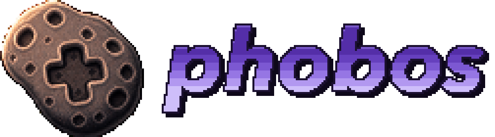

<p align="center">
  
</p>

**Phobos** is a multi-system emulator for **Android**, forked from [ares](https://github.com/ares-emulator/ares) (which began development on October 14th, 2004 as a descendant of [higan](https://github.com/higan-emu/higan) and [bsnes](https://github.com/bsnes-emu/bsnes/)). It focuses on accuracy and preservation, with Android-specific engineering layered on top: ARM64 work on ares's N64 recompilers and its Vulkan/parallel-RDP renderer, custom Turnip/Adreno driver loading, a Jetpack Compose UI, and a **PlayStation Portable core of its own**, written for Phobos (new in 2.0, and marked experimental while it's polished). The same cores also run in a desktop program for Linux, macOS and Windows.

> ares deliberately trades some speed for code clarity (state machines and bitmasks are avoided where possible). Phobos keeps that philosophy for the cores but adds performance-oriented backends around them, so the clarity remains while the hot paths run fast.

## Download

- **[Releases](https://github.com/pwnedbygary/phobos/releases):** tagged versions (the latest is v2.0.0, the first with the PlayStation Portable), and a nightly pre-release for every
  push to `master`. Settings → About updates the app from either channel.
- Each Android build comes in two flavors: **Modern** (ARMv8.2-A with FP16 and dot product instructions, which most devices from 2018 on have) and **Legacy** (any 64-bit ARM device). Both need Android 8.0 or newer.
- Tagged releases also carry the desktop program: a Linux AppImage, a universal macOS app and a Windows `Phobos.exe`.

---

## Systems

| System | Status |
|---|---|
| **Verified working on-device** | |
| Nintendo 64 | ✅ JIT CPU + RSP, Vulkan/parallel-RDP, upscaling, 64DD, Rumble/Controller Pak, save states + battery saves confirmed |
| Game Boy Advance | ✅ RTC clock matches host (Pokemon Unbound verified), battery saves + save states |
| Game Boy / Color | ✅ |
| Super Famicom / Famicom | ✅ |
| Mega Drive / Game Gear | ✅ |
| Master System | ✅ |
| PlayStation | ✅ DualShock + analog toggle, memcards, save states, multi-disc swap (MGS verified), Ape Escape opening cinematic verified |
| Neo Geo Pocket / Color | ✅ BIOS settings (language/date) persist |
| WonderSwan / Color | ✅ |
| MSX / MSX2 | ✅ On-screen MSX keyboard; tapes (`.cas`, `.wav`, `.tzx`, `.tsx`) run from the cassette motor as on the real machine (`CLOAD`, `BLOAD` or `RUN"CAS:"` with a BASIC BIOS set in Firmware; the bundled C-BIOS has none), up to 8x faster while they load; each game has a data tape for what it saves to tape (`CSAVE`, `SAVE"CAS:"`), in the pause menu's MSX section |
| Atari 2600, ColecoVision | ✅ |
| ZX Spectrum (48K and 128K) | ✅ Tape loading with automatic tape control and a faster-loading option, 48K keyboard, control schemes (Kempston, Sinclair, Cursor, QAOP and more) remembered per game, save states |
| SG-1000 | ✅ Verified 2026-08-14 |
| Mega CD | ✅ Audio fixed (lockstep multi-stream mixer, user-verified) |
| Mega 32X | ✅ Six games verified (Knuckles' Chaotix, Virtua Racing Deluxe, NBA Jam TE and others) |
| PC Engine (HuCard) | ✅ |
| PC Engine CD | ✅ Boots through System Card 3.0, read straight from the SD card (Rondo of Blood verified @60 FPS) |
| SuperGrafx | ✅ |
| Neo Geo (MVS/AES) | ✅ Graphics, controls and audio (KOF2003 verified @59.2 FPS); per-title compat matrix → [docs/neo-geo-compatibility.md](docs/neo-geo-compatibility.md) |
| Neo Geo CD | ✅ Boots, renders and has sound (Samurai Shodown verified), with the CDZ's double-speed drive and an optional faster loading speed |
| **Experimental (new in 2.0)** | |
| PlayStation Portable | 🧪 Phobos's own core: an exact software renderer and two Vulkan renderers, ISO/CSO/CHD and more, sound, music and movies, save states. Of 266 retail games run in the test runner, 196 reach a menu or gameplay and 69 play their opening movies → [PlayStation Portable](#playstation-portable-experimental) |
| **Added, not yet tried with a game on-device** | |
| Mega CD 32X, Super Game Boy, Arcade (Aleck64, SG-1000A) | Load paths, firmware slots and touch layouts are in |
| LaserActive (Mega LD, PC Engine LD) | `.mmi` discs read straight from the SD card; both PAC BIOSes boot (60 FPS on the RP6), and Side in the pause menu turns the disc over |
| Pocket Challenge V2 | `.pc2` games with the bundled boot ROM, its own buttons (Circle, Clear, Pass, View, Escape) and touch layout; a test cartridge runs at 75 FPS |

> Sega Saturn is not listed: upstream ares never completed the core (empty System::run stub,
> kept in the tree for future work).

### Known issues / not yet functional

- **Super Mario 64 B3313 v1.0.2 Hotfix 3** stops at a black screen (its UAA2 build runs), and **F-Zero ZX Overdrive**
  runs with a black picture; both N64 hacks are open in the implementation plan.
- **PlayStation Portable:** every game in the 266-game test library gets past its loading screens, but that's a minute
  of each, not a playthrough; God of War's games are still slow in the software renderer, and there's no network play.
  See [PlayStation Portable](#playstation-portable-experimental).

---

## PlayStation Portable (experimental)

The PSP core is Phobos's own, written for Phobos in ares's style from the PSP's documentation, tests and
measurements taken on a real PSP. No code comes from other PSP emulators: PPSSPP's code was read only as a reference
for how the PSP behaves, and nothing was copied, translated or reworded from it ([docs/psp-core.md](docs/psp-core.md)
records the work and its decisions, part by part). It's new in Phobos 2.0, and the app marks it Experimental while it's
polished.

- **No firmware needed.** The game's code runs on the emulated Allegrex and its display lists on the emulated GE, but
  the PSP's operating system is emulated at a high level: the kernel's threads, memory, files and timers, the
  system's dialogs and saves, sound (sceAudio, sceSas), music and movies (sceAtrac3plus, sceMp3, sceMpeg, scePsmf),
  sceJpeg, the system fonts and more are Phobos's own. Encrypted retail executables, and the data files games protect
  with PGD, are decrypted as a PSP decrypts them. Games that print with the PSP's own fonts need them from your PSP: `tools/psp-flash0-dump` copies its flash0
  to the memory stick, and Settings → Firmware's PSP fonts row takes the font folder in.
- **CPU:** the Allegrex (MIPS32 with its FPU and the VFPU) runs through a recompiler (sljit, ARM64 and x86-64) with
  an interpreter behind it, and loads and stores compile straight to RAM. The FPU's and VFPU's results, rounding and
  edge cases follow what a PSP measured ([docs/psp-vfpu-measurements.md](docs/psp-vfpu-measurements.md)).
- **Three renderers** (Settings → Emulation → PlayStation Portable):
  - **Software (exact)**, the default, draws every pixel as the PSP's GE does: its rounding, texture filtering,
    color and depth stepping, fog, lighting and perspective division are fitted to the PSP's own output, measured
    with `tools/psp-measure`. It splits each picture among the device's cores (PSP Drawing Threads, up to 8), and
    every thread count draws the very same picture.
  - **Vulkan (accurate)** draws on the GPU as close to the PSP as it can, at the PSP's 480x272 or up to 10x over
    (PSP Resolution); what games read back stays exact.
  - **Vulkan (fast)** also transforms and lights 3D on the GPU: the fastest, a little less exact.

  Vulkan uses the driver chosen in the GPU Driver Manager, keeps its compiled pipelines between sessions, and hands
  over to the software renderer if it can't start.
- **Discs and programs:** ISO, CSO (v1 and v2), ZSO, DAX, JSO and CHD images, read in place, and homebrew as PBP,
  ELF or PRX. The Library shows each disc's own title and icon.
- **Sound, music and movies:** sceAudio's channels and sceSas's voices are mixed by the core; ATRAC3, ATRAC3plus,
  MP3 and the movies' H.264 are decoded by FFmpeg's LGPL decoders, which the build makes itself (see
  [Building](#building-phobos)).
- **Saves and states:** the memory stick is a folder, shared by every game or at a path you choose. Save states are
  versioned, so states saved by earlier builds keep loading.
- **Controls:** the PSP's own touch layout, and controllers mapped as on every other system.
- **Compatibility:** in the [compatibility report](docs/psp-compatibility.md)'s runs (each of 266 retail games run
  headless for a minute of PSP time), 196 reach a menu or gameplay and 69 play their opening movies, and the last plays
  its opening a few seconds later; none stops at a missing system function. Speed is measured on a Retroid Pocket 6
  (Snapdragon 8 Gen 2) as the work goes; docs/psp-core.md has the tables.
- **Tested in CI:** the Allegrex's instructions, the kernel's functions, the GE against the PSP's measurements, save
  states, and the Vulkan renderer (on Mesa's software Vulkan driver) run on every change to the core
  (`tests/allegrex`, `tests/psp`).

---

## Desktop (Linux, macOS, Windows)

The cores also build as a desktop program (`desktop/`, on SDL 3): a Linux AppImage, a universal macOS app (Vulkan
through the bundled MoltenVK) and a Windows `Phobos.exe`, built by CI for every pull request and on `master`, and
attached to tagged releases.
Its interface is still a simple one in SDL's debug font: a library (disc sets, cue/m3u, PSP titles read off the
discs), a pause menu (save states, reset, fast-forward, mute, disc change, the N64's and PS1's options), the ZX
Spectrum and MSX keyboards, rumble, and firmware matched by content as the app matches it.

---

## Phobos vs. ares — what changed, technically

Phobos is not a UI reskin: it carries substantial core and platform engineering. The main differences:

### 1. JIT recompilers (CPU + RSP)

- **N64 CPU (VR4300):** ares compiles N64 code with an sljit-based recompiler (`ares/n64/cpu/recompiler*.cpp`); Phobos tunes it for ARM64. Blocks link straight to each other (jumps within and across sections, and not-taken branch edges), loops stay inside their block instead of returning to the dispatcher, an exact idle-loop skip runs while fast-forwarding, and in-block self-modifying code is invalidated through the cache dirty-line mechanism. The CPU Recompiler switch is in the N64 settings and the pause menu.
- **RSP:** the RSP recompiler emits the multiply and multiply-accumulate vector instructions as inline NEON, keeping the accumulator in NEON registers between them; the other vector instructions go through `sse2neon`.
- **Synchronization cadence:** the N64 core uses ares' synchronous model (`CPU::synchronize()` drives VI/AI/RSP/RDP directly; the ares co-routine Scheduler is unused by N64, as upstream). Count/Compare include the clocks run since the last sync, so a game's timer can't fall behind Count and wait a full wrap.
- **PSP CPU (Allegrex):** a new recompiler on the same sljit, with the VFPU's vector instructions compiled too (see [PlayStation Portable](#playstation-portable-experimental)).

### 2. N64 rendering: Vulkan + parallel-RDP

- ares renders the N64 with **parallel-RDP on Vulkan** (`ares/n64/vulkan/`, vendored `parallel-rdp/`). Phobos adds:
  - A **command ring + timeline worker + pipeline-compile threads**.
  - **Pipeline cache persistence** (user-configurable path, copy-on-change) so shader compilation doesn't repeat every launch.
  - **Internal upscaling** (1x–4x), **VI post-processing** bypass toggle, **supersample scanout**, and **weave deinterlacing** options.
  - An opt-in **Asynchronous RDP** (N64 Experimental; the default stays synchronous), up to 256 render contexts in flight, and binary fences on Turnip, whose emulated timeline semaphores made GPU submits wait.
  - **Non-fatal RDP validation:** a malformed command (e.g. a 4-bit VRAM pointer from a save-state load) is logged and skipped instead of crashing the RDP (upstream aborts). This fixed a hard freeze on some save-state restores.
- The Vulkan `VkDevice` is kept alive across soft resets (the fragile destroy/recreate path is avoided), and bounded waits were added to `CommandRing::drain`, `wait_for_timeline`, and the scanout fence.

### 3. GPU driver loading (libadrenotools / Turnip)

- Phobos can load a **custom Mesa/Turnip Vulkan driver** (e.g. `libvulkan_freedreno.so`) via [libadrenotools](https://github.com/bylaws/libadrenotools) (`thirdparty/libadrenotools`), which the parallel-RDP pipeline can't always use the stock Adreno driver for. The **GPU Driver Manager** downloads, installs and deletes drivers, can notify when the source you installed from has a newer one, and applies the choice at app start; the N64 and the PSP's Vulkan renderers both use it.

### 4. 64DD support

- The N64 core's **64DD** path is wired end-to-end: the 64DD IPL has Japan, US and development firmware slots, a secondary `.ndd` medium can be mounted (JNI `loadSecondaryRom` → native disk mount on the Floppy Disk port), and the pause menu's Disk action changes disks. Verified with F-Zero X Expansion Kit at 60fps.

### 5. Input, paks, and controller features

- **Rumble Pak / Controller Pak** (Player 1 N64): selectable from the pause menu, hot-swappable, with `save.pak` persistence and Android vibration (polled via JNI).
- **PS1 DualShock** analog toggle (DualShock ↔ Digital Gamepad) at runtime; rumble routed to the Android vibrator with a 150ms latch so short pulses are felt.
- **N64 C-buttons** are reachable from the right stick; stick-axis bindings latch through digital hysteresis matching ares' InputAnalog qualifiers.
- A per-core input cache (`inputButtonCache`/`inputAxisCache`) is keyed by raw node pointers and invalidated whenever the controller node tree is rebuilt (toggle/disk-mount/reload) — fixing stale-binding regressions.
- **Controls remapped** for one game, one console or all of them, from the pause menu's Controller section or Settings → Inputs & Hotkeys, and **hotkeys** for the emulator's own actions.
- **Touch controls** with a layout per system (the PS1's buttons in their own shapes), resized and moved in an editor, with their look, feel, D-pad and analog stick tuned in Settings → Touch Controls ([docs/touch-controls.md](docs/touch-controls.md)).

### 6. Platform / save handling

- **Saves Path, Vulkan Cache Path, States/Screenshots** are user-configurable via SAF; internal-storage fallbacks keep saves safe when no path is set.
- Save import runs **before** the cartridge port connects (the cores read their save files from the medium pak at connect time) — a fix that restores GBA SRAM/EEPROM/Flash/RTC state on every load instead of starting blank.
- **GBA RTC detection** was broadened: ares detects RTC by scanning for the literal `SIIRTC_V`; ROM hacks like Pokemon Unbound split the driver marker (`SII\0RTC_V0018\0`), so Phobos also matches the `RTC_V001` prefix (mGBA-style heuristic). Verified: Unbound passes its RTC check.
- **GBA RTC clock is host-seeded:** a fresh S3511A RTC is initialized with the host date/time (not the 2000 epoch), and legacy saves whose RTC year is behind the host year are auto-reseeded on load. Verified: Pokemon Unbound's in-game clock matches the host.
- **Auto-Save State / Auto-Load State:** an always-available "Auto" save-state slot (also reachable from the slot cycler after slot 9, and manually save/load/delete-able) is saved automatically on quit and restored on load when enabled. Both toggles live in Settings and the in-game pause menu, for all cores.
- **N64 save import and export:** the pause menu's Save Data section imports a game's battery save from Mupen64Plus (`.eep`, `.sra`, `.fla`, `.mpk`), RetroArch (`.srm`, compressed or not) or a Phobos backup, and exports it in any of those formats. Mupen64Plus and RetroArch store SRAM and FlashRAM with every 32-bit word reversed, which the conversion undoes. An import first moves the save it replaces, and the game's auto-save state (which would restore the old save), to a Backups folder beside the save, then restarts the game.
- **Multi-disc games:** a game's discs are one Library entry with a disc chooser, and on the PlayStation the pause menu's Disc action hot-swaps the disc tray (disconnect → allocate → connect) with the game paused, re-reading the new disc's `cd.rom` + TOC without reloading the console.
- **Games load from where they are:** a game the app can read by path is read straight from storage (CD images included), with no copy in the app's cache; Phobos keeps saves in its own folder, never beside the ROM.
- **Firmware is matched by content:** Settings → Firmware's Scan Folder identifies each BIOS by the SHA-256 of what the core reads (ares's firmware list, the copies Phobos bundles, MAME's Neo Geo CD BIOSes), whatever the file is called, and each slot shows Verified, Unrecognized, Unreadable or Built-in.

### 7. N64 timing/QoL knobs (Mupen64Plus-FZ style)

- **VI Overclock** (1x–2x): the VI runs at a genuinely higher frame rate; game logic executes faster.
- **Count Per Operation** (1/2/3) and **R4300 Overclocking Factor** (0–5 = 2^f): CP0 Count scaling and peripheral-cycle division, each behind a "use default" checkbox.
- **N64 Debug Logging** toggle: gates the per-second `N64 PC:`/`N64 STALL/HANG` diagnostics (off by default so logs stay clean and no per-frame core-state reads cost CPU).
- Profile counters are compiled out of release builds (`#if !defined(NDEBUG)`).

### 8. The app

- **Themes:** 37 of them, from Material You wallpaper colors and Phobos's gold on deep space to One Dark, Dracula, Nord, Catppuccin, Gruvbox, Rosé Pine and Synthwave '84, each with Light / Dark / Auto where it has both; style effects (glass, retrowave neon, an XMB-style backdrop), and backdrops (pixel-art scenes, manga ink, 16-bit RPG, retrowave) for the app and its screensaver.
- **Shaders:** RetroArch Slang presets (`.slangp`) through librashader, plus color emulation, interframe blending and overscan in Settings → Video.
- **Performance Monitor:** an in-game HUD with FPS, frame times and system stats, in presets or metric by metric; press and hold it in a game to move or resize it.
- **Library:** console illustrations drawn in the theme's colors, Platform Visibility to hide systems you don't use, and games started from frontends (below).

### 9. CI / distribution

- GitHub Actions builds **release-only** APKs (legacy + modern flavors) on every commit. A version tag (`v1.2.3`) publishes a GitHub Release, and every push to `master` publishes a nightly pre-release; both carry `update.json` for the in-app updater (Settings → About), which installs the newer build of the installed flavor through Android's installer. Debug builds are never published.
- The desktop program is built for Linux (AppImage + zsync), Windows and macOS for every pull request and on `master`, and attached to tagged releases.
- The PSP core's tests (the Allegrex CPU tests, and the PSP system tests with the Vulkan renderer's on Mesa's software driver) run on every change to it.
- Every build is numbered from git history, locally and on CI alike: version code 200000 + the commit count (100000 + it before 2.0), version name the tag on a tagged commit and `<tag>-<commits since>-g<hash>` otherwise.

---

## Neo Geo (MVS/AES) emulation

Phobos targets **perfect compatibility** for the Neo Geo MVS/AES library. Notes for users:

- **Scope:** strictly **Neo Geo MVS/AES** for the cartridge core — it is **not** a general arcade core (the Arcade system runs the other boards ares has, Aleck64 and SG-1000A). Neo Geo CD is a separate core (see the systems table).
- **Ported from MAME:** cartridge decryption and banking for the protected sets (CMC/CMC42/CMC50/SMA/PCM2/PVC, the kof2k2 family), the LSPC zoom table and the RTC protocol come from MAME (BSD-3-Clause, notice in [LICENSE](LICENSE)) — other arcade boards are not emulated by this core.
- **Status:** graphics (sprite zoom tables + vflip/zoom decode, mirroring MAME), controls and audio work (KOF2003 confirmed on-device); player 2 needs a second controller on a handheld.
- **Per-title compatibility matrix:** [docs/neo-geo-compatibility.md](docs/neo-geo-compatibility.md) — 288 titles, categorized by protection (PVC/K2K2/CMC42/CMC50/PCM2/SMA/bootleg/standard) and ranked hardest-first, with Boot/Gfx/Audio/Ctrl status columns.
- **Controls:** Neo Geo default mapping (Xbox-layout reference) — **X→A, Y→B, A→C, B→D, R1→A+B, R2→C+D, L1→B+C, L2→A+B+C, R3→B+C+D** (multi-bit combos). Buttons can be remapped for one game, a console or all consoles from the pause menu's Controller section or Settings → Inputs & Hotkeys.

---

## Starting games from a frontend

ES-DE and Daijisho can start games in Phobos, and Argosy will once its maintainers accept
Phobos's registry entry ([rommapp/argosy-launcher#471](https://github.com/rommapp/argosy-launcher/pull/471));
[docs/frontends.md](docs/frontends.md) has the setup for each. The Retroid Pocket's
own launcher has a fixed emulator list and can't.

---

## Building Phobos

Requires the Android SDK (platform 37, build-tools 36, NDK 28.x, CMake 3.22.1),
a JDK 17+, and the `thirdparty/libadrenotools` submodule
(`git submodule update --init --recursive`). From the `android/` directory:

```sh
./gradlew assembleRelease        # release APKs: app-legacy-release.apk + app-modern-release.apk
./gradlew assembleDebug          # debug APKs for both flavors
```

APKs land in `app/build/outputs/apk/<flavor>/<type>/`.

The PSP core's music and movies are decoded by FFmpeg's LGPL decoders, which the build makes itself from FFmpeg's
release with `thirdparty/ffmpeg/build.sh` (a few minutes, once; kept in `.cache/ffmpeg`). That needs bash, make, curl
and xz, and network access on the first build to download the release's tarball (checked against its SHA-256).
Offline, put the tarball (`ffmpeg-9.0.2.tar.xz`) in `.cache/ffmpeg`, or name it in `PHOBOS_FFMPEG_TARBALL`, or build
without FFmpeg, and so without the PSP's music and movies:

```sh
./gradlew assembleRelease -Pphobos.ffmpeg=OFF
```

The desktop program (`desktop/`) is built with CMake from the repository's root, with a preset for each platform
(`linux-x64`, `windows-x64` under MSYS2 UCRT64, `windows-x64-cross` with MinGW-w64 from Linux, `macos-universal`):

```sh
cmake --preset linux-x64
cmake --build build/linux-x64
```

It plays PSP games too, from a `psp` folder or any folder (they're told from the PlayStation's by what's in them), and
builds FFmpeg the same way, for the build's own platform; its two libraries go beside the program.
`-DPHOBOS_FFMPEG=OFF` builds it without them. The PSP core's tests run with `tests/allegrex/run-tests.sh` and
`tests/psp/run-tests.sh`.

High-level Components
---------------------

* __ares__:       Phobos' emulator cores and component implementations (ares fork), the PSP core (`ares/psp`) among them
* __android__:    main GUI implementation written in Kotlin and C++ featuring a JNI bridge to the Phobos cores.
* __desktop__:    the desktop program (SDL 3) for Linux, macOS and Windows
* __nall__:       Near's alternative to the C++ standard library
* __mia__:        internal ROM database and ROM/image loader
* __libco__:      cooperative multithreading library
* __tests__:      host tests for the cores (the Allegrex, the PSP, and CPU test suites for others)
* __tools__:      the PSP's runner, measuring program and font dumper, and the logo's build scripts
* __thirdparty__: parallel-rdp, sljit, libadrenotools, volk, librashader, libchdr, FFmpeg's build

License
-------

Phobos's own code is licensed under the GNU General Public License, version 3 or (at your option) any later version;
the license's text is in [COPYING](COPYING). The components Phobos builds on keep their own licenses, all listed in
[LICENSE](LICENSE). The console firmware that ares ships isn't covered by the GPL (see Phobos's notice at the top of
LICENSE).

Contributing
------------

Please join my discord [[HERE]](https://discord.gg/EkSNHnmYma) if you have any questions/wish to contribute.
