# Development progress

<!-- Generated by tools/progress/render.py from docs/progress/data.json: edit the data, then run the script. -->

How Phobos and its PlayStation Portable core came to be: the eras, the firsts, the measured progress, the releases, and the setbacks with what changed after them. The PSP core went from its first instruction on 3 October 2026 to its fifth release, v2.4.0, on 16 October, measured as it went on a Retroid Pocket 6 (Snapdragon 8 Gen 2) and a PSP-1000. As of 17 October 2026.

- **13 days** from the PSP core's first instruction (3 Oct 2026) to its fifth release, v2.4.0 (16 Oct)
- **197 of 266** games reach a menu or gameplay within a minute in the headless library run; 1 is still black there (73 were on 7 Oct)
- **18 of 22** games found slow on a Retroid Pocket 6 average full speed at 1x with the 15 Oct nightly (7 with v2.3.0)
- **232 of 266** games average 59+ fps at 5x internal resolution on the same device

## Timeline

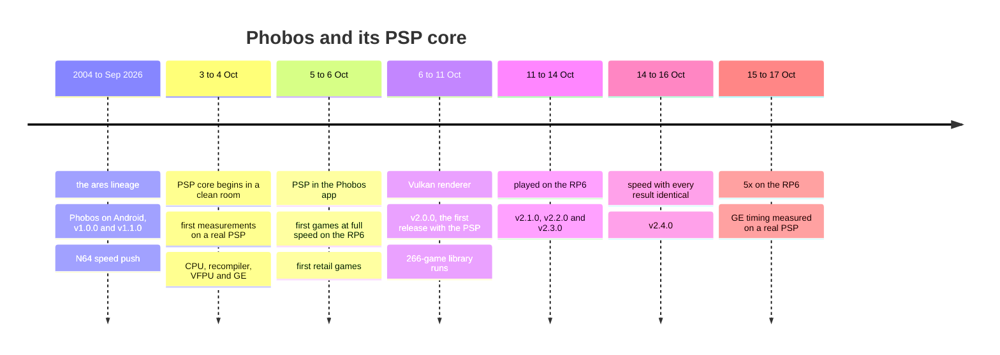

## Firsts

| Date | First |
|---|---|
| 27 Jul 2026 | Phobos runs on Android, the N64 on native Vulkan |
| 3 Oct | The PSP core's first code: the Allegrex interpreter |
| 3 Oct | First measurement on a real PSP: the VFPU, round 1 |
| 3 Oct | First program run from start to end: hello world, on the host |
| 5 Oct | First run inside the app on the RP6, at 60 fps |
| 5 Oct | First retail title screens: Lumines, Street Fighter III 3rd Strike |
| 6 Oct | First 3D games in play: Liberty City Stories, SOCOM, Burnout Legends |
| 6 Oct | First retail games at full speed on the RP6: Peace Walker, Liberty City Stories, Lumines |
| 6 Oct | First run of the whole 266-game library, headless |
| 7 Oct | First frames drawn on the GPU through Vulkan |
| 11 Oct | First release with the PSP: v2.0.0 |
| 14 Oct | First commit measured on the RP6 before it merged (#255) |
| 15-16 Oct | First whole-library pass at 5x on the RP6 |
| 16 Oct | First GE timing captured on a real PSP |

## The eras

### 1. Roots: ares, Android and a fast N64 (2004 to 2 Oct 2026)

Phobos is a fork of ares, whose lineage runs back to 2004 through higan and bsnes. It came to Android in July 2026 and shipped v1.0.0 in August; late September went to N64 speed and a themed app, and a PSP core of Phobos's own went on the plan.

| Date | Milestone |
|---|---|
| 2004 | **ares's lineage begins** — ares began on 14 October 2004 as a descendant of higan and bsnes; this repository carries that history from bsnes in August 2010 onward. |
| 27 Jul 2026 | **Phobos on Android** (a first) — The 64-bit native Android scaffolding, and native Vulkan for the N64 core, on the same day. |
| 20 Aug 2026 | **v1.0.0** (release) — Neo Geo core support, the GPU driver manager, stable release signing, PC Engine and SuperGrafx working. |
| 15 Sep | **A change process with evidence** — Performance claims need measurements, and a change needs an independent review of its exact snapshot before it merges. |
| 24 Sep | **The first pull request merged (#1)** — Neo Geo CD's garbled title-menu text: a DMA's byte order. |
| 25-28 Sep | **The N64 speed push** — JIT blocks linked and loops kept inside them (dispatcher round trips 10.1 to 0.6 million a second), the RSP's multiply-accumulates as inline NEON, up to 256 parallel-RDP render contexts in flight (Mario Tennis' showcase: 82 late frames to 5), WFE instead of spinning (4.76 to 4.15 W). |
| 27-28 Sep | **The app's look** — 37 IDE colorway themes with optional Retrowave effects (#9) and a MangoHud-style performance HUD (#5), then glass panels and a floating dock (#20). |
| 28 Sep | **v1.1.0** (release) — Pull requests #1-#25: the N64 work, the HUD, the themes and glass, and frontends that can start games (ES-DE, Daijisho, Argosy). |
| 28 Sep | **In-app updates** — Phobos updates itself from GitHub releases, every build numbered from git history (#26). |
| 29 Sep | **A PSP core on the plan** (decision) — A core of Phobos's own, to rival PPSSPP in compatibility and speed; the PS2 and GameCube generation left out as too complex to do properly. |
| 30 Sep-3 Oct | **Breadth** — Neo Geo CD's sound and loading speed, multi-disc games with a disc chooser, PS1 memory cards per game, ZX Spectrum and MSX keyboards and tapes, PC Engine CD, LaserActive and the Pocket Challenge V2. |
| 3 Oct | **Desktop builds and a license** — A Linux AppImage, a Windows Phobos.exe and a macOS app (#97); Phobos's own code under GPL-3.0-or-later, the firmware outside it (#98). |

### 2. A clean room, and the foundations (3-4 Oct 2026)

In two days: the rules (an original core, PPSSPP only as a reference for how the PSP behaves), the Allegrex CPU as an interpreter and a recompiler, the VFPU, the memory map, loader and first system functions, the GE drawing in 2D, in 3D and with lighting, and three rounds of measurements on a real PSP.

| Date | Milestone |
|---|---|
| 3 Oct | **The rules** (decision) — An original core in ares's style. PPSSPP and its test programs may be read for how the PSP behaves; nothing is copied, translated or reworded. Retail programs decrypted with the published keys; the PSP's system emulated at a high level, so no firmware is needed; a recompiler from the start, the interpreter as its reference. |
| 3 Oct | **Part 1: the Allegrex interpreter** (a first) — The PSP's CPU, its integer and FPU instructions, with host tests (14 groups, run under sanitizers). |
| 3 Oct | **Parts 2-4: the recompiler, the VFPU, loads and stores straight to RAM** — Built on ares's sljit framework for ARM64 and x86-64 and tested against the interpreter: 500 generated programs must end identically on both, and four deliberately broken recompilers each failed them. |
| 3 Oct | **The first measurement on a real PSP** (a first) — A homebrew program measured the VFPU on a PSP (round 1, firmware 6.61): its random numbers matched every word, vadd, vsub, vmul and vdiv every result, and sine and cosine were made exact. |
| 3 Oct | **Parts 5-9: memory, loader, first system functions, files, the GE's lists** (a first) — pspdev's hello world ran from start to end on the host (part 7). |
| 4 Oct | **Parts 10-12: drawing in 2D, in 3D, and lighting** — Each with its own measuring program run on a real PSP, the GE's pictures compared with the core's. |
| 4 Oct | **Rounds 2 and 3, then one measuring program** — Matrices, division by zero, NaNs, denormals, comparisons and prefixes matched the PSP; the FPU's rounding and conversions and the GE's rounding, sampling, filtering and lighting were fitted. The tests became one program with a menu (tools/psp-measure). |
| 4 Oct | **The stack** — The parts gathered into one GitHub stack of pull requests, to merge as one. |

### 3. Into the app, and the first games (5-6 Oct 2026)

The core became an ares system inside the Android app, read disc images, saved states, decrypted retail games, made sound and drew text with the PSP's own fonts. On 6 October its first retail games ran at full speed on the RP6, and a headless runner began testing all 266 games of the test library.

| Date | Milestone |
|---|---|
| 5 Oct | **A flash0 dumper** — tools/psp-flash0-dump copies a PSP's system files, the fonts among them, to its memory stick; the copies stay on the user's devices, never in the repository. |
| 5 Oct | **Part 13: the PSP in Phobos** (a first) — pspsdk's samples and hello ran in the app on the RP6 at 60 frames a second (the cube's frame about 8 ms of its 16.7). |
| 5 Oct | **Parts 14-16: discs and save states** — ISO and CSO, then CHD, CSO v2, ZSO, DAX and JSO; save states, versioned. |
| 5 Oct | **Parts 17-19: retail games start** (a first) — The functions retail games ask for, ~PSP programs decrypted, modules loaded from the disc and the memory stick. On the host, Lumines reached its title screen, and Street Fighter III 3rd Strike's port its own at 60 fps. |
| 6 Oct | **Part 21: sound** — sceAudio's channels mixed and sceSas's voices heard. |
| 6 Oct | **Part 22: the first 3D games in play** (a first) — On the host: Liberty City Stories into the city, SOCOM's first mission, Burnout Legends and Midnight Club 3 racing. |
| 6 Oct | **Part 23: the system fonts** — sceLibFont drawing a PSP's own flash0 fonts. |
| 6 Oct | **Part 24: full speed on the RP6** (a first) — The software renderer on several threads with a texture cache, every pixel as before: Peace Walker's title 10.6 to 60 fps, Liberty City Stories 16.6 to 60, Lumines' demo 24.0 to 59.9. |
| 6 Oct | **Parts 25-27** — The first test games into gameplay (Burnout Dominator's GE hang explained), music and movies through FFmpeg's LGPL decoders, and the PSP in the desktop program. |
| 6 Oct | **The headless runner and the 266-game report (#154)** (a first) — Every game run headless for a minute of PSP time; the first, rough count put about 100 games at a menu or in play and about 155 black. |

### 4. The GPU, and the whole library (6-11 Oct 2026)

An exact compute renderer gave way to a hardware renderer on Vulkan; the 266 games ran again and again until one was left black; God of War, the PGD-protected games and measurement rounds 4 to 6 followed; and v2.0.0 shipped the core, marked Experimental, on 11 October.

| Date | Milestone |
|---|---|
| 6-7 Oct | **Parts 28-33** — The functions 266 games ask for; lines, bounding boxes and DXT textures; the software renderer 1.9-3.6x faster again and bit-exact, four pixels at a time; PSMF movies from a clean room; Bezier and spline surfaces. |
| 7 Oct | **Part 36: a hardware renderer on Vulkan** (a first) — The exact compute renderer (parts 34-35) stopped. On the RP6, one Vulkan thread beat the seven-thread software renderer in all six scenes measured. |
| 7-8 Oct | **Parts 38-45: faster, and in the app** — The recompiler compiles more and chains blocks (Midnight Club 3's race 24.2 to 32.3 fps on the RP6), a Renderer setting that takes custom drivers, upscaling up to 10x, blending in the shader. |
| 8 Oct | **OpenGL parked** (decision) — Most phones and handhelds run Vulkan, so the time went to the software renderer's waits and Vulkan's accuracy instead. |
| 8 Oct | **The VFPU adder's carry** — Its rounding now carries into the exponent, and the twitching limbs seen in GTA were gone. |
| 9 Oct | **Part 51: the whole library again** — Three regressions fixed; black screens from 73 to 21 of 266. |
| 9 Oct | **Parts 53-54: Vulkan (fast)** — The GPU transforms and lights 3D; compiled pipelines kept between sessions. |
| 9 Oct | **Rounds 4, 5 and 5B on the PSP** — Round 4 froze the PSP at its curve counts, so the program's waits for the GE were timed and a stall reset (#191). |
| 10 Oct | **God of War, and round 6 written** — God of War in the software renderer, and in Vulkan without waiting for the GPU (parts 64-65); round 6 measures the GE's time, lighting's cosine, the reciprocal and curves. |
| 10-11 Oct | **The PGD games decrypt** — A fix for PGD-protected disc reads (#206): the six black games' data decrypts; five reach their titles, menus or notices, and the sixth is still loading at the minute mark (its opening plays from about frame 4,200). |
| 11 Oct | **#208: the stack merged into master** — About 100 pull requests, #100 to #209, as one. |
| 11 Oct | **v2.0.0: the first release with the PSP** (release) — Marked Experimental in the app. In the runner's final run, 194 of 266 games reached a menu or gameplay, 71 their movies, and 1 stayed black. |

### 5. Playing it on the RP6 (11-14 Oct 2026)

With v2.0.0 on a Retroid Pocket 6, the games were played. Each report became a fix, three more releases followed in three days, and a test plan became CI lanes.

| Date | Milestone |
|---|---|
| 11 Oct | **The RP6 run of v2.0.0** — The formerly troubled games, then the whole test library, with buttons pressed whenever a game sat idle. #212-#219 merged that night: WipEout without waiting for the GPU; MACH taking Start; new saves no longer called corrupted; a PSP section in the pause menu with uses for the right stick; Crash Tag Team Racing's save dialog; Kenka Bancho and Final Fantasy IV past their movies; both Metal Gear Acids' menus; the game's name beside “Emulation Paused”. |
| 12 Oct | **#221: the system's dialogs in the app** — A game's messages, keyboard, and save and load screens shown as the app's own dialogs, answered by touch or controller. |
| 12 Oct | **#222: round 6's pictures** — Lighting's two multiplies, the measured reciprocal, the texel range and patches, fitted to what a real PSP drew in round 6 the night before. |
| 12 Oct | **v2.1.0** (release) — Those fixes, the dialogs and round 6: 12 pull requests. |
| 12-13 Oct | **The slow games, first rounds** — Render to texture decoded only where it's taken, Killzone's blur from a copy, calmer system calls, more of the VFPU compiled (#224, #233); Vulkan no longer waits for its own pixels (#234). |
| 13 Oct | **v2.2.0** (release) — Six pull requests: the slow-game rounds, Colin McRae's save, anti-aliased lines, savedata. |
| 13 Oct | **More of the library** — Dissidia's and Type-0's saves, sceFont fixes (Jeanne d'Arc, Final Fantasy III, Hammerin' Hero), God Eater 2 in English from downloaded modules, ATRAC contexts and sceVaudio, and CPU round 2: the VFPU's adder in NEON, blocks linked. |
| 13-14 Oct | **The test plan's CI lanes** — Android unit tests gate releases; the renderer's shaders recompiled and validated; the PSP as an ares system and the runner in CI; ARM64 lanes. #241's and #247's lanes were shown to fail when they should, on negative-control pull requests (#242, #248). |
| 14 Oct | **v2.3.0** (release) — 15 pull requests: the games above, CPU round 2, the CI lanes and a faster GE front end. |

### 6. Speed with exactness (14-16 Oct 2026)

Every speedup had to leave every result identical, proved by matching end states and a check of the whole library. Polling loops were skipped only where proved exact, GPU draws were cut, CPU and GE rounds were measured on the RP6 itself, and games found in play were fixed. v2.4.0 shipped on 16 October.

| Date | Milestone |
|---|---|
| 14 Oct | **#252: polling loops skipped where proved exact** — The Need for Speeds and intro movies at full speed on the RP6. |
| 14 Oct | **#251, #254: Vulkan's depth and stencil** — The depth buffer kept as the PSP's memory: Hammerin' Hero's and Jeanne d'Arc's characters, Cars' race and MX vs. ATV Untamed's race back. |
| 14 Oct | **#255: the runner on Android** (a first) — A commit measured on the RP6 from adb before it merges. Killzone's slower fast-forward was bisected with it: not a regression, but the device's conditions. |
| 14 Oct | **#253: GE round 3** — Far fewer GPU draws: Ghost of Sparta's menu from 3,684 to 346 a frame in Vulkan (fast), every output identical. |
| 14 Oct | **#256, #257: CPU round 3, LittleBigPlanet's install** — Hot Wheels' FPU compiled (3.5% less CPU time a frame on the RP6); files reopened with truncate keep their bytes, as on a PSP. |
| 15 Oct | **#259, #258, #260, #261** — Download content decrypted (EDATA); Kurohyou's characters at the screen's middle; MediEvil's and Lumines II's saves; Kingdom Hearts Birth by Sleep Final Mix's data install, the game-data install dialog built. |
| 15 Oct | **#262: GE round 4A** — #253's extra cycles on the RP6's Cortex-X3 won back (Super Monkey Ball: 7.6% less CPU time a frame). |
| 15 Oct | **18 of 22 slow games at full speed** — At 1x on the RP6 with nightly-215681; v2.3.0 had 7. |
| 16 Oct | **#263: PGD files on the memory stick** — Gunhound EX and 7th Dragon 2020 play from the data #261 installs. |
| 16 Oct | **v2.4.0** (release) — 16 pull requests, released after an RP6 check of #263's nightly. |

### 7. 5x, and the real PSP's GE (15-17 Oct 2026)

At 5x internal resolution a few heavy games collapsed. The RP6 wasn't the limit (PPSSPP holds 60 there); how Phobos draws was. Then a PSP-1000 measured its own GE: real display lists take 4 to 12 times what Phobos's model charged, which is why Phobos's games drew 2.7 to 14 frames per screen refresh where a PSP draws 0.5 to 1.8.

| Date | Milestone |
|---|---|
| 15-16 Oct | **The whole library at 5x** (a first) — Overnight on the RP6 (Vulkan fast, 2400x1360): no crashes in 266, 232 averaged 59+ fps, and Chains of Olympus fell from 59.6 at 1x to 9.8. |
| 16 Oct | **The collapse traced** — Every heavy scene GPU-bound at 5x: a shader that writes depth stops the GPU skipping hidden pixels, and Activision Hits copied its depth 28 times a frame through a staging buffer. |
| 16 Oct | **PPSSPP at 5x on the same RP6** — 59.8 to 60.0 fps in all 11 games tried, a black-box comparison. |
| 16 Oct | **The GE measured on a real PSP** (a first) — A GE profiler plugin under ARK custom firmware on a PSP-1000: Chains of Olympus, Ghost of Sparta, Super Monkey Ball, Killzone and Activision Hits, then Army of Two. Lists took 4 to 12 times the model's time. |
| 16-17 Oct | **The GE timing plan** (decision) — Six pull requests, #266-#271, all drafts but round 8's #270: the profiler, the power driver's clocks, GE sync polling skipped, the measured model behind a “PSP GE Timing” switch (off by default), round 8 of psp-measure, and the display's frame-buffer latch. |
| 16 Oct | **#265: the first 5x fixes** — Depth copied image to image where a start-up check proves it safe: Activision Hits' copyright screen 2.7 to 19.4 fps at 5x (15.4 to 247 at 1x). |
| 16 Oct | **#264: Colin McRae's dropped Cross** — The core's and the app's input paths cleared, and an opt-in input log for one capture on the RP6. |
| 17 Oct | **#272 (in review): the GE on a thread of its own** — Exact and Off by default. With it On, every settled scene and every long, randomized and stress run matched Off; the library check then found a Ghost of Sparta crawl, fixed the same day; the suite reached 595 groups. |

## Progress, measured

### Compatibility

<picture>
  <source media="(prefers-color-scheme: dark)" srcset="images/progress/library-runs-dark.svg">
  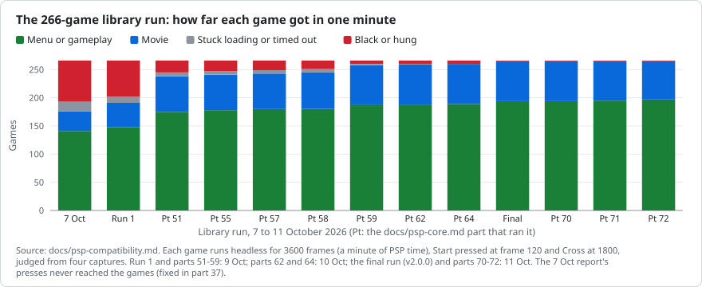
</picture>

### Speed

<picture>
  <source media="(prefers-color-scheme: dark)" srcset="images/progress/slow-games-dark.svg">
  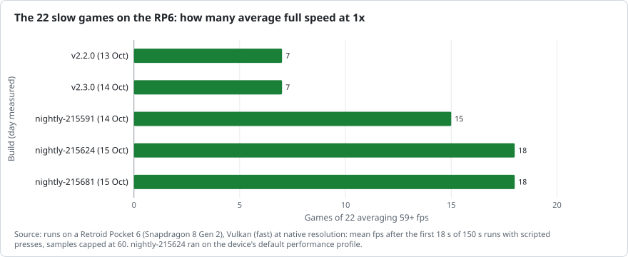
</picture>

<picture>
  <source media="(prefers-color-scheme: dark)" srcset="images/progress/part24-full-speed-dark.svg">
  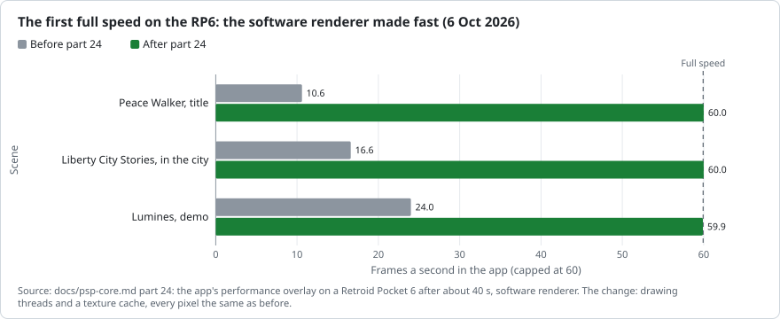
</picture>

<picture>
  <source media="(prefers-color-scheme: dark)" srcset="images/progress/part36-renderers-dark.svg">
  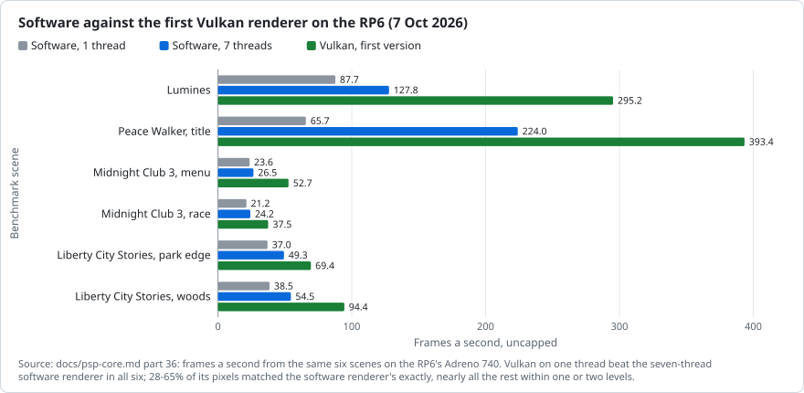
</picture>

<picture>
  <source media="(prefers-color-scheme: dark)" srcset="images/progress/cpu-throughput-dark.svg">
  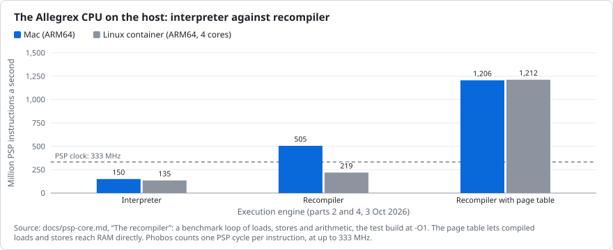
</picture>

### Higher resolutions, and the real PSP's GE

<picture>
  <source media="(prefers-color-scheme: dark)" srcset="images/progress/rp6-5x-scenes-dark.svg">
  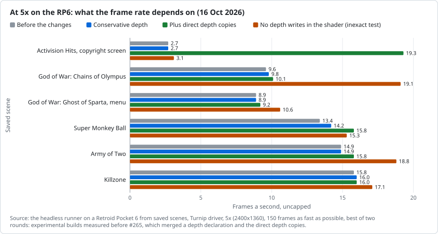
</picture>

<picture>
  <source media="(prefers-color-scheme: dark)" srcset="images/progress/ppsspp-5x-dark.svg">
  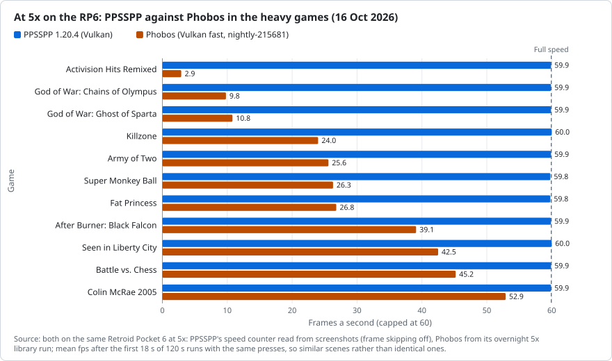
</picture>

<picture>
  <source media="(prefers-color-scheme: dark)" srcset="images/progress/ge-list-time-dark.svg">
  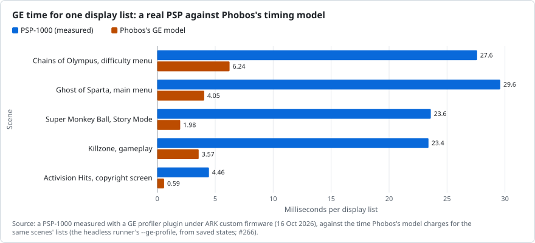
</picture>

### Pace

<picture>
  <source media="(prefers-color-scheme: dark)" srcset="images/progress/prs-per-day-dark.svg">
  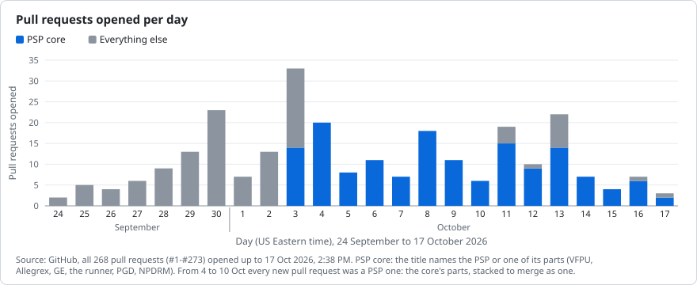
</picture>

<picture>
  <source media="(prefers-color-scheme: dark)" srcset="images/progress/merges-per-week-dark.svg">
  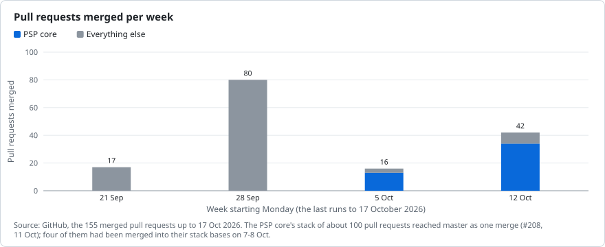
</picture>

<picture>
  <source media="(prefers-color-scheme: dark)" srcset="images/progress/docs-parts-dark.svg">
  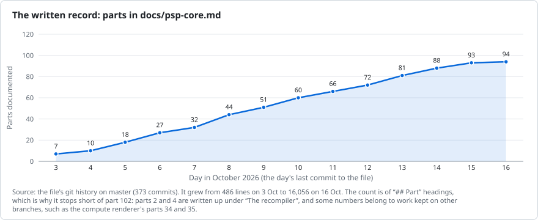
</picture>

<picture>
  <source media="(prefers-color-scheme: dark)" srcset="images/progress/test-groups-dark.svg">
  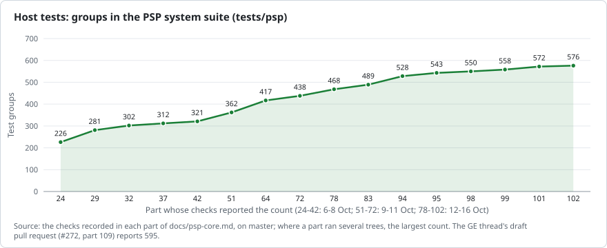
</picture>

## Releases

| Release | Date | Pull requests | Highlights |
|---|---|---|---|
| v2.4.0 | 16 Oct 2026 | 16 | Polling loops, Vulkan depth and stencil, GE rounds 3 and 4A, CPU round 3, the runner on Android, LittleBigPlanet, Kurohyou, Kingdom Hearts' install, EDATA and PGD on the memory stick, new backdrops |
| v2.3.0 | 14 Oct 2026 | 15 | Savedata, sceFont, God Eater 2, ATRAC and sceVaudio, CPU round 2, the test plan's CI lanes, a faster GE front end |
| v2.2.0 | 13 Oct 2026 | 6 | The slow games' first rounds, Vulkan without waiting for its own pixels, Colin McRae's save, anti-aliased lines |
| v2.1.0 | 12 Oct 2026 | 12 | Fixes from playing v2.0.0 on the RP6, the system's dialogs in the app, round 6's pictures |
| v2.0.0 | 11 Oct 2026 | #26-#102 and the PSP stack (#208) | The PSP core, Experimental: the stack, the headless runner and its report, disc titles; with September's app and core work |
| v1.1.0 | 28 Sep 2026 | #1-#25 | The N64 speed push, the MangoHud-style HUD, 37 themes and the glass look, frontends that start games |
| v1.0.0 | 20 Aug 2026 | before pull requests | Neo Geo core support, the GPU driver manager, stable release signing, PC Engine and SuperGrafx working |

Between releases, every push to master publishes a nightly pre-release: 32 nightly tags are dated 11-16 Oct 2026.

## Setbacks and lessons

| When | What happened | What changed after |
|---|---|---|
| 3-4 Oct | An automated reviewer answered “no bugs found” while its reasoning described bugs. | Every change now gets an independent, read-only review that reads the code itself. |
| 4 Oct | The PSP switched itself off during measurement round 2. | The measuring program keeps the PSP awake and gives up on a test that stops it twice. |
| 6-7 Oct | The first library reports' button presses never reached the games, and a re-run showed 22 games going from a menu to black. | The presses were fixed (part 37) and the black games traced (part 51 fixed three regressions); a game that looks worse is run again without presses before it's called a regression. |
| 7 Oct | The exact compute renderer (parts 34-35) couldn't be expected to match hardware rasterization, least of all when upscaling. | A hardware renderer on Vulkan came first, the compute work kept on a branch; the software renderer stays the exact reference. |
| 7 Oct | A stale object file in a test harness, and a comparison that restored state every frame, made early renderer scores wrong. | Both were fixed before any number was published; a deliberately broken renderer must now show as broken. |
| 9 Oct | Round 4 froze the PSP at its curve counts. | The program's waits for the GE are timed, and a stall is reset (#191). |
| 12-17 Oct | Network outages and interrupted work sessions. | Plans and state are written down as work goes, so it resumes where it stopped. |
| 14 Oct | Too many parallel jobs overloaded the build machine, and jobs died. | At most about three heavy jobs run at once, library checks included. |
| 14 Oct | #253's per-draw shortcuts, a clear win on the Mac, cost 2-3% more cycles on the RP6's Cortex-X3. | Changes are measured on the device itself (#255's runner); #262 won the cycles back. |
| 16 Oct | A cleanup deleted a temporary folder a library check needed, and its runs aborted; the same day a broadly matched process kill stopped unrelated test runs. | Scripts create their own temporary folders, and processes are stopped by their own IDs only. |
| 16 Oct | A pull request (#265) was merged before its library check had finished: a stale completion marker, and missing results treated as clean. | The check came back clean that night (266 games in each Vulkan mode, no real difference), so the merge stands. Merges now wait for a fresh result, scripts fail closed, and nothing merges automatically. |
| 16 Oct | An early reading of the PSP captures suggested a game ran overclocked. | The readings predated the game, which ran at 222/111 MHz as Phobos assumes; the docs were corrected. |
| 17 Oct | A library-check wrapper lost DYLD_LIBRARY_PATH (macOS strips it when perl starts bash), so a “Vulkan fast” pass ran the software renderer and reported 199 false differences. | The wrapper exports it, and a smoke run must show the Vulkan renderer. The one real finding, Ghost of Sparta crawling with the GE thread on, was fixed. |

## Sources

Drawn from this repository's git history and docs (docs/psp-core.md, docs/psp-compatibility.md, tools/psp-measure/README.md, README.md), its GitHub releases and pull requests, and the project's measurement logs from a Retroid Pocket 6 and a PSP-1000. Dates are US Eastern (UTC-4).

This page, the charts and README.md's Development progress section are generated: edit docs/progress/data.json, then run `python3 tools/progress/render.py`. With `--check` it writes nothing and fails if any of them no longer matches the data.
